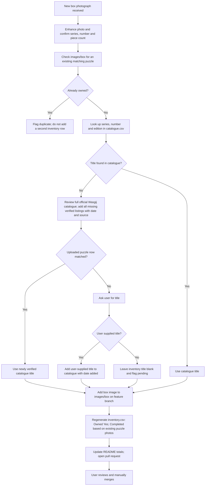
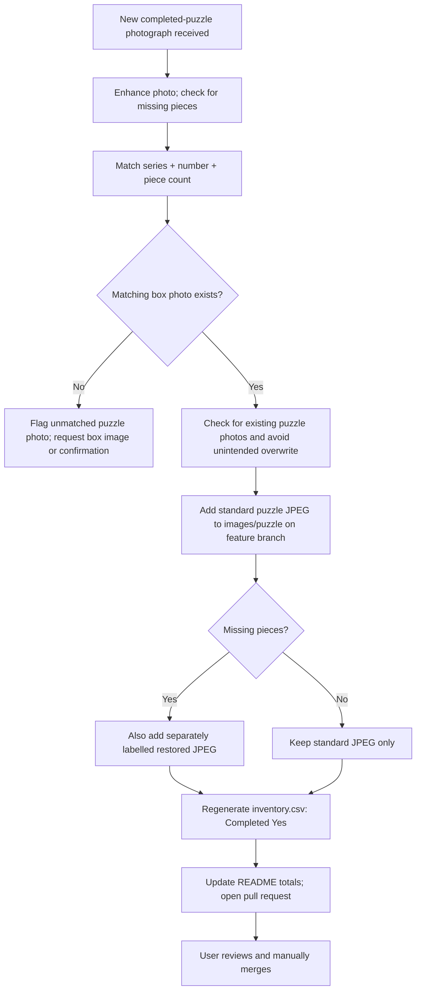

# Wasgij puzzle collection

Personal archive of owned Wasgij jigsaws and photographs of completed puzzles.

## Folder layout

| Path | Purpose |
| --- | --- |
| [images/box](images/box) | Box photographs; determines which puzzles are **owned** |
| [images/puzzle](images/puzzle) | Finished-puzzle photographs; determines which puzzles are **completed** |
| [inventory.csv](inventory.csv) | Inventory of owned puzzles and completion status |
| [catalogue.csv](catalogue.csv) | Growing puzzle title catalogue (publisher-verified and user-supplied) |
| [PROJECT_INSTRUCTIONS.md](PROJECT_INSTRUCTIONS.md) | ChatGPT project workflow and photo-enhancement requirements |

## Inventory

Current inventory (based on the image filenames): **110 owned**, **55 completed**, **55 not yet completed**.

Every distinct combination of **series + number + piece count** with a box image is one owned puzzle. A matching finished-puzzle image marks it completed. A `2x1000` edition contains one 1000-piece standard puzzle and one 1000-piece puzzle reproducing the box image; it still counts as one owned entry. Multiple photos of the same puzzle count once. Completion is inferred from file presence, not independently verified from the photograph.

The CSV columns are: `Series`, `Number`, `Title`, `Piece Count`, `Owned`, `Completed`, `Notes`. Titles are matched by series, number and compatible piece count. Unknown titles remain blank until confirmed. `Notes` describes special editions and collector's boxes.

## Image naming

- `Wasgij - Christmas - No.01 (1000) - Box.jpg`
- `Wasgij - Christmas - No.01 (1000) - Puzzle.jpg`
- `Wasgij - Christmas - No.01 (1000) - Puzzle (Restore pieces).jpg` (if applicable)

Use two digits for numeric numbers below 10. Descriptive identifiers (e.g. `No.Volume1`) are preserved. Where multiple puzzle photographs exist, numbered suffixes such as `Puzzle1.jpg` are supported.

## Maintenance

When adding, removing or renaming a box or completed-puzzle photo, update `inventory.csv` using the same series, number and piece-count matching rules. See [project instructions](PROJECT_INSTRUCTIONS.md) for enhancement and archiving standards.

## Puzzle title catalogue

The separate [catalogue CSV](catalogue.csv) began with **173 distinct listings** transcribed from [Wasgij's official puzzle archive](https://wasgij.com/collections/archive) (pages 1–8, checked 25 October 2026). It includes series, puzzle number, title, listed piece count, source, and `Date Added` (YYYY-MM-DD). The original 173 entries were discovered on 25 October 2026 and carry `2026-10-25`; new entries receive their actual date added. Entries can be verified from the publisher or supplied by the user.

This is a **growing reference catalogue, not a guaranteed complete official history**: the official archive may omit historical editions, special releases, or listings not present in those pages. Some original editions have different piece counts from modern reissues. Do not automatically treat catalogue entries as owned or completed, and do not change archive image filenames solely to match official titles.

## Proposed archive workflows

### 1. New box photograph — add an owned puzzle

**Rules:** Box-image presence alone establishes ownership, even without a known title. Search the local catalogue first. If the title is missing, review the full available [Wasgij catalogue](https://wasgij.com/collections/archive), including paginated and current listings, and add **all** missing verified listings (not only the uploaded puzzle) to `catalogue.csv` with source and current `Date Added`, then retry matching. Ask the user if the title remains unknown; add user-confirmed titles with source and date; leave the title blank pending confirmation otherwise. Do not guess titles or equate different editions solely by puzzle number. Preserve the source photograph. Do not modify `main` directly.

### 2. New completed-puzzle photograph — mark completion

**Rules:** Only a standard matching completed-puzzle photograph marks an owned puzzle as completed; a restored-only file does not. Multiple photographs count as one completion. If no box image exists, report the unmatched photo rather than adding an owned row. All updates require a feature branch, pull request and manual merge.

